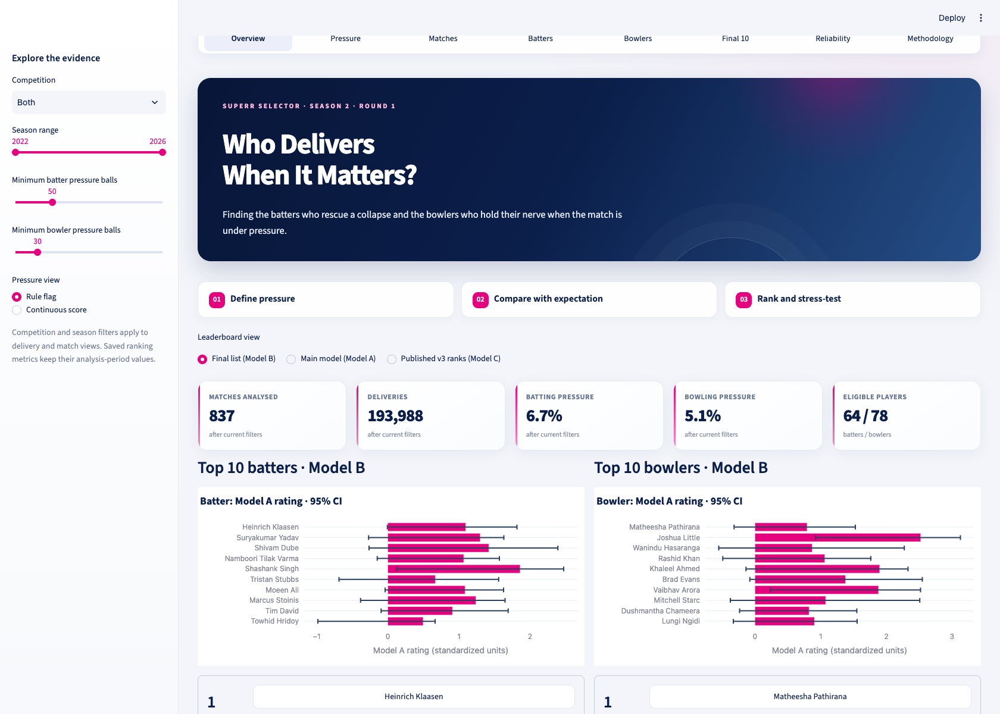

# SupeRR Selector S2 · Round 1

## Who Delivers When It Matters?

An interactive Streamlit and Plotly dashboard presenting the SupeRR Selector Season 2 Round 1 analysis of player performance under pressure. It uses precomputed analysis files and preserves the submitted pressure definitions and final rankings.

### Dashboard preview



### Explore the analysis

The dashboard contains eight pages: **Overview**, **What is Pressure?**, **Match Explorer**, **Batter Deep-Dive**, **Bowler Deep-Dive**, **Final Top 10 and Evidence**, **Reliability and Limits**, and **Methodology and Downloads**.

It includes side-by-side pressure and baseline metrics, match-level exploration, fixed submitted top tens, published Model C comparisons, and reliability checks.

### Run locally

Requires Python 3.12. From the repository root:

```bash
python3.12 -m venv .venv
source .venv/bin/activate       # Windows: .venv\Scripts\activate
python -m pip install -r dashboard/requirements.txt
streamlit run dashboard/app.py
```

Open the local URL printed by Streamlit, usually `http://localhost:8501`. Precomputed data is included in `dashboard/data/`; no preprocessing is required to run the app.

### Deploy to Streamlit Community Cloud

1. Select this GitHub repository and the `main` branch.
2. Set **Main file path** to `dashboard/app.py`.
3. Choose Python 3.12 and deploy.

### Analysis scope and limitations

The app covers IPL and T20I matches from 2022 onwards. Its prepared data contains 837 matches and 193,988 deliveries. The source PDF reports 867 raw-source matches and 200,999 deliveries; 30 non-IPL T20 matches are outside the dashboard analysis scope. Some player samples are small, split-half rank stability is low (Spearman about 0.1), and venue/opposition strength adjustments are unavailable. Full details and reproducibility instructions are on the dashboard’s **Methodology** and **Reliability and Limits** pages.

See [`dashboard/README.md`](dashboard/README.md) for the complete project, data, test, and screenshot documentation.
